<h1 align="center">Identity and governance for people and their agents</h1>

<p align="center">
  <a href="https://docs.proofable.me/benchmark"></a>
  <a href="https://proofable.me/benchmarks/security"></a>
</p>

<p align="center">
  <a href="https://www.npmjs.com/package/@proofable/sdk"></a>
  <a href="https://github.com/proofable/sdk/blob/main/LICENSE"></a>
  <a href="https://docs.proofable.me"></a>
  <a href="https://discord.gg/cpNJVuq4UW"></a>
</p>

<p align="center">
  <a href="https://proofable.me">Website</a>
  |
  <a href="https://docs.proofable.me">Docs</a>
  |
  <a href="https://docs.proofable.me/benchmark">Benchmarks</a>
  |
  <a href="https://github.com/proofable/agent">Agent template</a>
  |
  <a href="https://codespaces.new/proofable/agent">Open in Codespaces</a>
</p>

<p align="center">
  <picture>
    <source media="(prefers-color-scheme: dark)" srcset="images/terminal-dark.svg">
    
  </picture>
</p>

⭐ *Help us reach more developers. Star [proofable/agent](https://github.com/proofable/agent).*

Proofable gives every agent you run across Claude Code, Cursor, Codex, ChatGPT and any MCP client its own identity and a permission you sign, checks every action against it outside the agent before it runs, and leaves a receipt anyone can verify offline.

**Agents that can't do what you never allowed.**

---

## Where it stands

The results come from the design, not from tuning for a test: every action is checked against a permission its owner signed before it runs, and leaves a receipt anyone can verify. Two industry benchmarks:

| Benchmark | Result |
|---|---|
| **NVIDIA Live Agent Gauntlet** | Winner. The top score of the tournament, 98.00, across 20 teams and 11 live heats, with every call checked before it ran |
| **AgentDojo** (ETH Zurich, prompt injection) | Attacks that landed fell from 16.4% to 6.2% on the same model, with 87% of tasks still done under attack |

Method, sources and raw results for every row, plus our own tests (a hijacked agent, forged receipts) with how to rerun them: [docs.proofable.me/benchmark](https://docs.proofable.me/benchmark). The forgery test runs with [no account](https://github.com/proofable/docs/tree/main/public/evidence/checks).

---

## Proofable Overview

Proofable is the authority layer your agents answer to. You sign what an agent may do: its tools, its spend, its end date, and which steps wait for your yes. Every call is decided outside the agent's process before it runs, so a fooled or hijacked agent still can't cross the line. Built for developers who let agents do real work and need to prove what they did.

**Key Capabilities:**

- **Its own identity** - every agent gets an ID tied to the person or business it works for
- **A permission instead of a key** - tools, spend cap, expiry and approvals, signed by the owner and checked before every call
- **Keys it uses and never sees** - credentials stay in a vault; the agent gets the result, never the secret
- **Revoke once, stop everywhere** - one revoke stops every copy of the agent in every tool
- **Receipts anyone can check** - every action is a signed record that verifies offline, without trusting us

---

## 🚀 Quick Start

### 1. Install Proofable

**Copy & paste setup prompt into your coding agent**

```text
Set me up for Proofable. With a terminal, run `npx -y @proofable/sdk setup`. Otherwise fetch and follow https://raw.githubusercontent.com/proofable/mcp/main/skills/proofable-setup/SKILL.md
```

Or connect any MCP client to `https://mcp.proofable.me/mcp`.

### 2. Use your agents normally

Your agents keep working in the tools you already use. Anything outside the permission is stopped before it runs, and anything you marked for approval waits for your yes.

### 3. Check the receipts

Every receipt verifies offline. Try to forge one:

```bash
git clone --depth 1 https://github.com/proofable/docs
cd docs/public/evidence/checks && npm install && node tamper-check.mjs
```

150 forgery attempts across ten kinds of tampering, 150 caught. No account needed.

---

Free to start with 500 credits a month. Make it Proofable.
