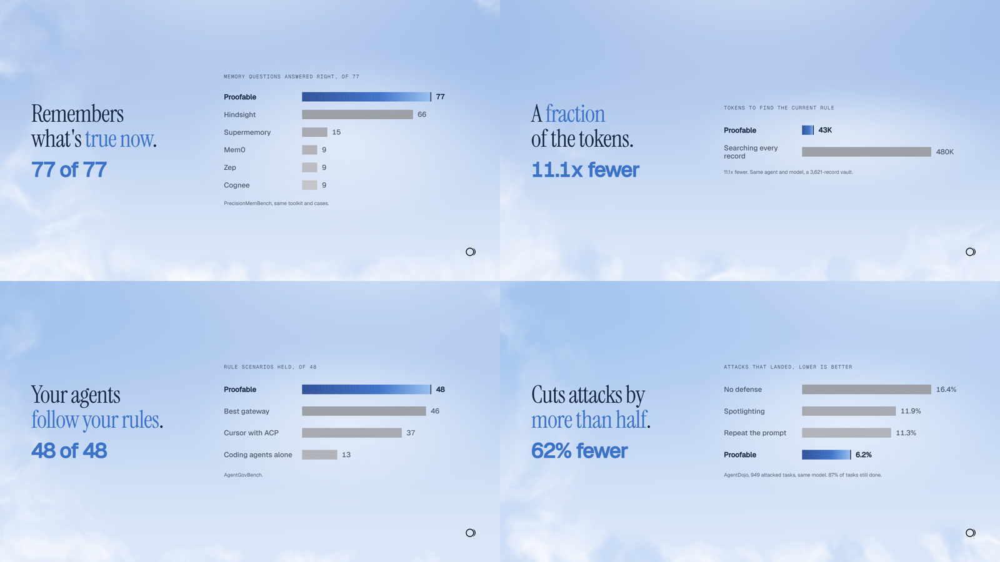

<p align="center">
  
</p>

<h1 align="center">One profile every AI tool you use already knows</h1>

<p align="center">
  Your notes, rules, agents and keys, loaded with only what is true now.<br>
  Right answers at a fraction of the tokens, and agents that stay inside your rules,<br>
  in Claude, ChatGPT, Codex, Cursor, Hermes and any MCP client.
</p>

<p align="center">
  <a href="https://www.npmjs.com/package/@proofable/sdk"></a>
  <a href="https://github.com/proofable/sdk/blob/main/LICENSE"></a>
  <a href="https://docs.proofable.me"></a>
  <a href="https://discord.gg/cpNJVuq4UW"></a>
</p>

<p align="center">
  <a href="https://proofable.me">Website</a>
  |
  <a href="https://docs.proofable.me">Docs</a>
  |
  <a href="https://proofable.me/benchmarks">Benchmarks</a>
  |
  <a href="https://github.com/proofable/mcp">MCP server</a>
  |
  <a href="https://github.com/proofable/agent">Agent template</a>
</p>

## Start in one command

Paste this into your coding agent:

```text
Set me up for Proofable. With a terminal, run `npx -y @proofable/sdk setup`. Otherwise fetch and follow https://raw.githubusercontent.com/proofable/mcp/main/skills/proofable-setup/SKILL.md
```

Or connect any MCP client to `https://mcp.proofable.me/mcp`. Every tool you connect then works from the same profile.

## The platform and the terminal

<table>
  <tr>
    <td width="50%" valign="top">
      
      <p><b>Your profile.</b> Every AI tool connects to the same agents and limits. Keys stay hidden, permissions are one record, and the risky calls wait for you.</p>
    </td>
    <td width="50%" valign="top">
      <picture>
        <source media="(prefers-color-scheme: dark)" srcset="images/terminal-dark.svg">
        
      </picture>
      <p><b>Your terminal.</b> The same rules run wherever the agent does. Allowed calls go through, anything else stops before it runs, and every action leaves a record you can check offline.</p>
    </td>
  </tr>
</table>

## What you get

- **Every tool, one memory.** Claude, ChatGPT, Codex, Cursor and Hermes load the same profile, so nothing gets explained twice.
- **Only what is true now.** Each fact knows whether it still holds, so the old one never outranks the new one, and a tool reads a fraction of the tokens.
- **Agents inside your rules.** Tools, spend cap, end date and approvals, checked before every call. Revoke once and it stops everywhere.
- **Keys they use and never see.** Credentials stay in a vault. The agent gets the result, never the secret.
- **Work you can check instead of redo.** Every action leaves a signed record that verifies offline in milliseconds.

## Results

<p align="center">
  <a href="https://proofable.me/benchmarks"></a>
</p>

| Benchmark | Result |
|---|---|
| **PrecisionMemBench** (agent memory) | **77 of 77**, tied for first. Hindsight 66; Mem0 and Zep 9 |
| **Finding the current rule** (3,621-record vault) | **43,169 tokens** against 479,623 searching every record: 11.1x fewer |
| **AgentGovBench** (agent rules) | **48 of 48**. Best gateway 46; coding agents on their own 13 |
| **AgentDojo** (ETH Zurich, prompt injection) | Attacks that landed fell from 16.4% to 6.2% on the same model, with 87% of tasks still done |
| **NVIDIA Live Agent Gauntlet** | #1 of 20 teams: 98.00 |
| **Hijacked agent** | **0 of 6** data-theft attempts got out, against 6 of 6 on an all-purpose key |
| **Forgery test** | **150 of 150** forged receipts caught |

Run the forgery test yourself, no account needed:

```bash
git clone --depth 1 https://github.com/proofable/docs
cd docs/public/evidence/checks && npm install && node tamper-check.mjs
```

Methods and raw results: [proofable.me/benchmarks](https://proofable.me/benchmarks)

## Repositories

| Repository | What it is |
|---|---|
| [**mcp**](https://github.com/proofable/mcp) | The MCP server every AI tool connects to, with setup skills and examples |
| [**sdk**](https://github.com/proofable/sdk) | `@proofable/sdk` and the `proofable` CLI, plus the offline verifier |
| [**agent**](https://github.com/proofable/agent) | An agent template that runs inside the rules you sign |
| [**docs**](https://github.com/proofable/docs) | Docs, benchmark evidence and verifier schemas |
| [**agent-gauntlet**](https://github.com/proofable/agent-gauntlet) | The NVIDIA Live Agent Gauntlet submission, receipts included |

Free to start with 500 credits a month. Make it Proofable.
