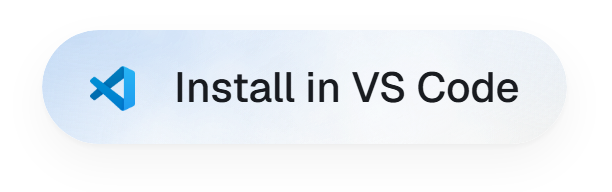

<p align="center">
  
</p>

<h1 align="center">Make AI do your work and prove it</h1>

<p align="center">
  <b>The portable proof layer for people, businesses and AI agents.</b><br>
  Every AI you use knows your work and follows your rules,<br>
  and every action leaves a receipt anyone can check.
</p>

<p align="center">
  <a href="https://proofable.me/u/proofable"></a>
  <a href="https://www.npmjs.com/package/@proofable/sdk"></a>
  <a href="https://discord.gg/cpNJVuq4UW"></a>
</p>

<p align="center">
  <a href="https://proofable.me/?ref=github">Website</a>
  |
  <a href="https://docs.proofable.me">Docs</a>
  |
  <a href="https://proofable.me/marketplace?ref=github">Marketplace</a>
  |
  <a href="https://proofable.me/benchmarks?ref=github">Benchmarks</a>
</p>

## Run every agent from one place

<p align="center">
  <a href="https://proofable.me/profile?tab=chat&ref=github"></a>
</p>

Approve, stop or chat with any agent, and see every run and the work it is on.

## The same rules in your terminal

<p align="center">
  <picture>
    <source media="(prefers-color-scheme: dark)" srcset="images/terminal-dark.svg">
    
  </picture>
</p>

Allowed calls go through. Anything else stops before it runs.

## Start in one click

<a href="https://cursor.com/en/install-mcp?name=proofable&config=eyJ1cmwiOiJodHRwczovL21jcC5wcm9vZmFibGUubWUvbWNwIn0%3D"></a>
<a href="https://vscode.dev/redirect/mcp/install?name=proofable&config=%7B%22type%22%3A%22http%22%2C%22url%22%3A%22https%3A%2F%2Fmcp.proofable.me%2Fmcp%22%7D"></a><br>
<a href="https://claude.ai/settings/connectors"></a>
<a href="https://chatgpt.com/plugins/plugin_asdk_app_6ae65c2bac0881918812c63246c7e6c9"></a>

Every AI tool on your machine, in one command. It finds Claude Code, Codex, Cursor and VS Code and adds Proofable to each:

```bash
npx -y @proofable/sdk setup
```

Or set up one client:

| Client | Set up |
|---|---|
| **Claude Code** | `/plugin marketplace add proofable/mcp` then `/plugin install proofable-mcp@proofable`, then run `/mcp` and sign in |
| **Claude** and **Claude Desktop** | [Open Connectors](https://claude.ai/settings/connectors), add `https://mcp.proofable.me/mcp` as a custom connector, then Connect |
| **ChatGPT** | [Install the plugin](https://chatgpt.com/plugins/plugin_asdk_app_6ae65c2bac0881918812c63246c7e6c9), then sign in |
| **Codex** | `npx -y @proofable/sdk setup --client codex` then `codex mcp login proofable` |
| **Cursor** | [Add to Cursor](https://cursor.com/en/install-mcp?name=proofable&config=eyJ1cmwiOiJodHRwczovL21jcC5wcm9vZmFibGUubWUvbWNwIn0%3D), then turn it on in Customize |
| **VS Code** | [Install](https://vscode.dev/redirect/mcp/install?name=proofable&config=%7B%22type%22%3A%22http%22%2C%22url%22%3A%22https%3A%2F%2Fmcp.proofable.me%2Fmcp%22%7D) or [Insiders](https://insiders.vscode.dev/redirect/mcp/install?name=proofable&config=%7B%22type%22%3A%22http%22%2C%22url%22%3A%22https%3A%2F%2Fmcp.proofable.me%2Fmcp%22%7D&quality=insiders), then start it from the MCP server list |
| **Hermes** | `hermes mcp add proofable --url https://mcp.proofable.me/mcp --auth oauth` then `hermes mcp login proofable` |
| **Any other client** | Add `https://mcp.proofable.me/mcp` in its MCP settings, then sign in |

Keep one Proofable connection per client. A plugin plus a manual entry creates a duplicate.

## What you get

- **Your work in every AI tool.** Notes, rules, agents and skills load from one profile, so you never explain them twice.
- **Only what is true now.** A new fact replaces the old one, so answers come out right at a fraction of the tokens.
- **Agents inside your rules.** Choose what each agent may do, cap its spend and set when its access ends. Irreversible actions wait for you, and one revoke stops it everywhere.
- **Keys they use and never see.** Credentials stay in a vault, bound to the agent that needs them.
- **A receipt for every action.** It checks offline in milliseconds, so the next agent trusts the work instead of redoing it.
- **Prove who you are once.** Reuse it in every app, gate your own app on it, and sell your agents and tools on the [marketplace](https://proofable.me/marketplace?ref=github).

## Results

| | Proofable | The usual way |
|---|---|---|
| Memory questions answered right ([PrecisionMemBench](https://proofable.me/benchmarks/memory?ref=github)) | **77 of 77** | Mem0 9 |
| Tokens to find the current rule | **43,169** | 479,623 searching every record |
| Rule scenarios held ([AgentGovBench](https://proofable.me/benchmarks/governance?ref=github)) | **48 of 48** | Best gateway 46 |
| Prompt injections that landed ([AgentDojo](https://proofable.me/benchmarks/security?ref=github)) | **6.2%**, with 87% of tasks done | 16.4% with no defense |
| Private data out of a hijacked agent | **0 of 6** | 6 of 6 on an all-purpose key |
| Forged receipts accepted | **0 of 150** | 150 of 150 by a format-only check |

Top score of 20 teams in NVIDIA's Live Agent Gauntlet, 98.00. [Every method and run](https://proofable.me/benchmarks?ref=github)

Try to forge a receipt yourself, no account needed:

```bash
git clone --depth 1 https://github.com/proofable/docs
cd docs/public/evidence/checks && npm install && node tamper-check.mjs
```

## Repositories

| Repository | What it is |
|---|---|
| [**mcp**](https://github.com/proofable/mcp) | The server every AI tool connects to, with one-click installs, plugins and setup skills |
| [**sdk**](https://github.com/proofable/sdk) | `@proofable/sdk` and the `proofable` CLI, plus the offline receipt checker |
| [**agent**](https://github.com/proofable/agent) | An agent template that works inside the rules you set |
| [**docs**](https://github.com/proofable/docs) | Docs, benchmark evidence and schemas |
| [**agent-gauntlet**](https://github.com/proofable/agent-gauntlet) | The submission that topped NVIDIA's Live Agent Gauntlet, receipts included |

Free to start with 500 credits a month. **[Start free](https://proofable.me/profile?tab=chat&ref=github)**

Make it Proofable.
